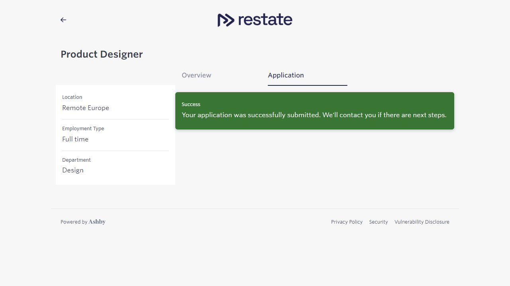

# Report candidature — 1 ottobre 2026

**20 candidature uniche con invio verificato, al netto di 3 email respinte.** Sono 16 email con conferma di invio Gmail e 4 conferme esplicite di moduli/ATS. La conferma Gmail non dimostra lettura, accettazione o ricezione da parte dell'azienda. Ultimo controllo delle notifiche di mancata consegna: sera del 1 ottobre, Europe/Rome; nessuna nuova respinta oltre alle tre indicate sotto.

Sono state effettuate 23 candidature uniche complessive per raggiungere 20 senza errori rilevati, seguendo la richiesta di escludere le respinte dalla quota. I clic di validazione e i caricamenti falliti senza invio non sono candidature aggiuntive.

Mittente verificato: saccullo.francesco@gmail.com. Mediakit incluso in tutti gli invii: https://francesco-saccullo-mediakit.web.app/ . Dove richiesto, utilizzato il nuovo PDF fornito dall'utente, `output/pdf/Francesco-Saccullo_CV_2027.pdf`, senza rigenerarlo. Presentazione sempre ampia tra design, prodotto, software development e AI; i titoli ufficiali degli annunci sono conservati qui.

## Candidature con invio verificato

**Contratti:** FT significa full-time, con durata non specificata. Nessuno degli annunci sotto è stato dichiarato a tempo indeterminato senza una conferma esplicita. Per i remoti senza elenco dei paesi è stata indicata l'Italia e richiesta verifica dell'idoneità geografica; tale idoneità resta da confermare dal datore.

| # | Azienda e ruolo / fonte ufficiale | Sede, modalità e contratto | Compatibilità e sintesi del testo | Canale ed esito |
|---|---|---|---|---|
| 1 | [VibenTech — Product Designer](https://vibentech.com/careers/product-designer) | Remoto, territorio non specificato; FT | Flussi di prodotto, Figma, componenti riutilizzabili e software development | info@vibentech.com, nuovo CV; Gmail «Messaggio inviato». Ripresa bozza precedente mai inviata |
| 2 | [Abyssal Interactive — UI/UX Designer, Train Station Tycoon](https://www.abyssal-interactive.com/en/careers/ui-ux-designer-train-station-tycoon) | Studio in Bretagna, Francia; remoto; freelance | **Priorità gaming**. Esperienza su applicazioni complesse e design system trasferibile a un gestionale. Nessuna esperienza Unity inventata | contact@abyssal-interactive.com, nuovo CV; Gmail confermato. Numero e possibilità di fatturare confermati dall'utente; modulo non inviato per problemi upload |
| 3 | [PulseApps — Product Designer (UI/UX)](https://pulseapps.tech/careers/) | Remoto mondiale; FT | Figma, prototipazione, design system e collaborazione con engineering | Modulo ufficiale: «Message received! We'll respond within 24 hours.» |
| 4 | [Governed — Senior Product Designer](https://governed.dev/careers) | Remoto, territorio non specificato; FT | Interazioni AI, chiarezza degli stati e dei controlli, Figma e React/TypeScript | careers@governed.dev; Gmail confermato |
| 5 | [thecybersol — Product Designer](https://thecybersol.com/careers.html) | Remoto, territorio non specificato; contratto non specificato | Flussi complessi, design system e interazioni AI, senza attribuire esperienza specialistica in sicurezza | info@thecybersol.com, nuovo CV; Gmail confermato. Indirizzo pubblicato nel modulo ufficiale; modulo non inviato |
| 6 | [Virtual Franciscans — Senior Product Designer](https://franciscans.dev/careers) | Remoto Europa; FT | Design system implementati, React/TypeScript e motion | hello@franciscans.dev; Gmail confermato. Specificata disponibilità ai soli test asincroni, da conciliare con il loro processo |
| 7 | [Glider11 — Product Designer](https://www.glider11.com/careers) | Remoto mondiale; FT; sovrapposizione oraria da concordare | Creazione assistita da AI, linguaggio visivo, motion e implementazione | careers@glider11.com; Gmail confermato |
| 8 | [LOQATE — Product Designer](https://loqate.zone/careers/product-designer) | Remoto, territorio non specificato; FT | Chiarezza di applicazioni ricche di dati, componenti e collaborazione con engineering; nessuna esperienza logistica attribuita | careers@loqate.zone, nuovo CV; Gmail confermato |
| 9 | [AVEA — Product Designer](https://avea.studio/product-designer) | Completamente remoto, territorio da confermare; FT | Figma, design system, React e prodotti AI | careers@avea.studio, nuovo CV; Gmail confermato |
| 10 | [Favist — Product Designer](https://www.favist.ai/careers) | Remoto mondiale; FT | Linguaggio visivo, modelli riutilizzabili e cultura creativa | careers@favist.ai; Gmail confermato |
| 11 | [Axra — Senior Product Designer](https://www.useaxra.com/careers/product-designer) | Remoto mondiale; FT | Chiarezza dei flussi, design system e motion; nessuna esperienza finanziaria inventata | careers@useaxra.com, nuovo CV; Gmail confermato |
| 12 | [Koreshield — Product Designer](https://koreshield.ai/careers/product-designer) | Londra/remoto, Italia da confermare; FT | Informazioni operative leggibili, interazioni AI e software development | hello@koreshield.ai; Gmail confermato |
| 13 | [LockedIn AI — Product Designer](https://www.lockedinai.com/careers/product-designer) | Remoto globale; FT | Design system, Jobrapido e progetti AI. Dichiarato di non aver provato il prodotto; suggerimenti presentati come ipotesi iniziali | careers@lockedinai.com, nuovo CV; Gmail confermato |
| 14 | [Dreambase — Design Engineer](https://dreambase.com/careers/design-engineer) | Austin o remoto con overlap; città USA preferite; Italia da confermare; durata non specificata | Figma, React/TypeScript, motion, componenti e AI. Inclusa proposta tecnica su stati, autorizzazioni, risultati strutturati e verifica delle risposte | jobs@dreambase.com, nuovo CV; Gmail confermato |
| 15 | [Universal Technologies — Product Designer](https://universal-technologies.com/careers/product-designer/) | Remoto globale con overlap; contract | Design system e passaggio dal brief al prodotto implementato. Proposta di partire da un flusso circoscritto | Modulo con nuovo CV: «Application sent» |
| 16 | [We The Flywheel — Brand Identity & Product Designer](https://wetheflywheel.com/en/careers/brand-product-designer/) | Remoto mondiale; freelance continuativo 10–15 ore/settimana, revisione iniziale a 3 mesi | Grayfox, Figma, componenti e workflow assistiti da AI. CV opzionale non allegato; forniti Mediakit e Figma | Modulo: «Application received! Thank you for applying.» |
| 17 | [Moodora — Product Designer](https://www.craftmydream.com/careers/) | Remoto Europa; FT | Gerarchia, motion discreto e chiarezza nella pianificazione di viaggi; esperienza Jobrapido e progetti indipendenti | hello@craftmydream.com, contatto collegato dal pulsante Apply; Gmail confermato |
| 18 | [Synthreo — Product Designer](https://synthreo.ai/careers/product-designer/) | Remoto globale, overlap da concordare; FT | Design e responsabilità di prodotto, componenti, AI e caso Grayfox | hr@synthreo.ai, nuovo CV; Gmail confermato |
| 19 | [Parousia Group — Senior Product Designer](https://www.parousiagroup.com/en/careers/senior-product-designer) | Regione Europa, Londra/remoto; Italia da confermare; FT | Figma, sistemi riutilizzabili e implementazione. Richiesto inoltro al team competente | careers@parousiagroup.com, nuovo CV; Gmail confermato. **Registrazione nel portale non confermata**: usato il contatto careers per l'instabilità degli upload |
| 20 | [Restate — Product Designer](https://jobs.ashbyhq.com/restate/f587a541-5b1f-4de5-ba0f-46f1e5a818c9) | Remoto Europa; FT; offsite occasionali non impegnati | Design di software complesso, motion, sistemi, AI e storytelling. Caso Grayfox documentato e proposta iniziale sul percorso di analisi delle esecuzioni | Ashby con nuovo CV: «Success — Your application was successfully submitted.» |

## Respinte escluse dal totale

| Azienda | Recapito pubblicato utilizzato | Esito verificato |
|---|---|---|
| OGO Technology | careers@ogo.tech, pubblicato su https://ogotechnology.net/careers | 14:51, dominio inesistente |
| Surfil | careers@surfil.com, https://surfil.com/careers | 14:52, indirizzo non trovato |
| TheDeskMonitor | careers@thedeskmonitor.com, https://thedeskmonitor.com/careers | 14:57, indirizzo non trovato |

Nessun indirizzo alternativo indovinato e nessun sollecito inviato.

## Priorità e opportunità non inviate

Il gaming è stato esplorato prima delle categorie inferiori. Abyssal è stata inviata appena disponibili i dati richiesti. VibenTech era una bozza pronta, ripresa mentre si attendevano tali dati. Nessuna candidatura a ruoli puramente frontend è stata usata per riempire la quota; le altre candidature appartengono alla categoria design, anche quando il prodotto usa AI.

- [Airship — UI Artist](https://careers.airshipinteractive.com/jobs/8281732-ui-artist): raccolta di profili freelance, non posizione attiva.
- [Hothead Games — Sr/Lead UX UI Designer](https://www.hotheadgames.com/jobs/sr%2Flead-ux-ui-designer): remoto limitato al Canada e ciclo di pubblicazione di giochi richiesto, non documentato.
- [Xenoss — Senior UI Designer](https://xenoss.io/careers/senior-ui-designer): pagina ufficiale 404.
- RoyalSpin, Ampersand e SekGames: precedenti candidature già registrate, nessun reinvio.
- GetNextSite, Avion Labs e Dreamcafe: elementi identificativi o recapiti segnaposto; sospese per verifica della fonte.
- [Framer — Product Designer](https://www.framer.com/careers/product-designer): descrizione presente ma nessun pulsante di candidatura visibile nella pagina verificata; non inviata. Per procedere occorre un canale attivo collegato dalle carriere ufficiali.
- [Collabify — Design Engineer](https://www.heycollabify.com/us/en/careers/design-engineer): valutata, non inviata in questa sessione; richiede modulo con CV. Resta una possibilità da completare, non una candidatura riuscita.
- [SunAlgo — Product Designer](https://sunalgo.com/careers/product-designer): valutata, non inviata; modulo con CV, località, aspettativa economica ed esperienza rilevante. Riutilizzare il PDF attivo se selezionata in una prossima sessione.

## Eventuali passi manuali

Non servono nuovi dati personali per completare gli invii di oggi. Per Parousia, attendere indicazioni del team sulla validità dell'invio via email; se richiede il portale, usare il collegamento sopra e lo stesso PDF, registrando il completamento come stessa candidatura. Non reinviare in parallelo. Abyssal e thecybersol sono state inviate via email dopo problemi di caricamento: anche in questi casi evitare duplicati nei moduli.

## Aggiornamenti di candidature precedenti

- Mailmark: ricevuta aziendale di candidatura Product Designer osservata nell'email del 30 settembre.
- WN Social: avviso temporaneo di consegna del 1 ottobre alle 11:35; Gmail segnala ulteriori tentativi per 46 ore. Ricezione non confermata, nessun reinvio.
- Bamudda: avviso del 1 ottobre alle 09:26 di indirizzo non trovato; aggiornata a consegna fallita.
- FlexiBooking: avviso di mancata consegna già presente il 30 settembre; nessun reinvio.

## Dati salvati

Nel profilo di progetto sono salvati il nuovo CV, il numero autorizzato per Abyssal e la possibilità di emettere fattura. Restano validi: disponibilità immediata, test tecnici esclusivamente asincroni, EUR 45.000 lordi annui quando richiesti, assenza di sponsorship necessaria in Italia. Le esperienze sono ricavate dal Mediakit e dalle conferme dirette dell'utente.

Registro completo: `applications.jsonl`. I conteggi progressivi registrati prima delle notifiche di respinta sono storici: il totale finale corretto è **20**, con **3 respinte escluse**.
